<div align="center">

# CANARY SRS
### Contamination Audit for Human-Written Datasets

[](https://github.com/Temkin236/canary-srs/actions/workflows/ci.yml)
[](docs/TESTING.md)
[](LICENSE)
[](https://www.python.org/)
[](https://fastapi.tiangolo.com/)
[](https://react.dev/)
[](https://www.typescriptlang.org/)
[](https://tailwindcss.com/)

**Privacy-first contamination investigation for human-written datasets.**  
*Transparent. Reproducible. Explainable. Human-controlled.*

```
Evidence, Not Verdict.
Canary finds structured evidence that human-written dataset answers may have been
contaminated by chatbot output. It is an evidence collection and human-review platform,
never an automated authorship judge or worker punishment mechanism.
```

[Key Features](#-key-features) • [Screenshots](#-screenshot-gallery) • [How It Works](#-how-it-works) • [Architecture](#-system-architecture) • [Accuracy](#-benchmark--empirical-accuracy) • [Getting Started](#-getting-started) • [Author](#-creator--author)

---

</div>

## 📸 Overview & Interface Preview

<div align="center">
  
  <p><em>Canary SRS: Deterministic, privacy-first evidence collection and reviewer platform investigating chatbot contamination in human-written datasets.</em></p>
</div>

<br />

<div align="center">
  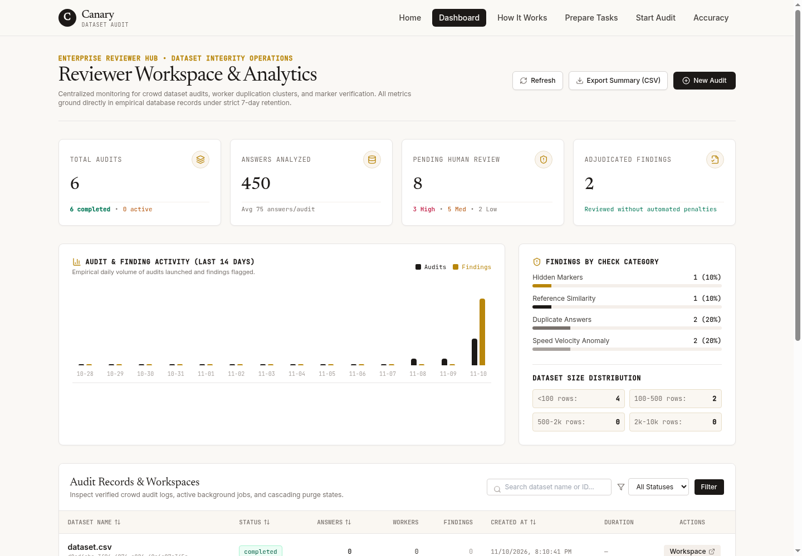
  <p><em>Enterprise Reviewer Workspace: Centralized analytics aggregating cross-audit findings, 14-day activity trends, check category distributions, and active dataset audits.</em></p>
</div>

---

## 📑 Table of Contents
- [Product Overview](#-product-overview)
- [Why Canary SRS?](#-why-canary-srs)
- [Key Features](#-key-features)
- [Screenshot Gallery](#-screenshot-gallery)
- [How It Works & Detection Methodology](#-how-it-works--detection-methodology)
- [System Architecture](#-system-architecture)
- [Technology Stack](#-technology-stack)
- [Privacy & Security Guarantees](#-privacy--security-guarantees)
- [Benchmark & Empirical Accuracy](#-benchmark--empirical-accuracy)
- [Engineering Highlights & Achievements](#-engineering-highlights--achievements)
- [Getting Started & Local Development](#-getting-started--local-development)
- [API Documentation](#-api-documentation)
- [Testing & Quality Control](#-testing--quality-control)
- [Repository Structure](#-repository-structure)
- [Limitations & Non-Goals](#-limitations--non-goals)
- [Roadmap](#-roadmap)
- [Contributing](#-contributing)
- [License](#-license)
- [Creator & Author](#-creator--author)

---

## 💡 Product Overview

Modern AI development depends critically on high-quality, human-written crowd annotations and vendor datasets. However, crowdsourced datasets are increasingly vulnerable to **covert LLM contamination**—workers copying prompts into chatbots and submitting generated answers.

Generic AI detectors rely on subjective **stylometry**, uncalibrated **perplexity**, or black-box classifiers that suffer from severe false-positive rates on non-native English writers and technical domain texts.

**Canary SRS** takes a radically different engineering approach:
1. **Deterministic, calibrated evidence** instead of probabilistic guesswork.
2. **Four multi-modal checks** operating 100% offline without external AI reliance.
3. **Dedicated human adjudication workspaces** giving dataset stewards transparent proof with explicit limitation notes.
4. **Strict privacy invariants** guaranteeing zero worker data leakage and automatic 7-day ephemeral purging.

---

## ⚖️ Why Canary SRS?

| Traditional "AI Detectors" | Canary SRS Platform |
|---|---|
| **Black-Box Probabilities**: Outputs arbitrary "92% AI-generated" scores with zero explainability. | **Transparent Artifacts**: Provides exact matched offsets, zero-width Unicode decodings, and side-by-side diffs. |
| **Stylometric Bias**: Penalizes non-native speakers, neurodivergent phrasing, and formal writing styles. | **Zero Stylometric Hallucination**: Ignores writing style; relies strictly on physical markers, peer percentiles, and duplicate clusters. |
| **Third-Party Surveillance**: Sends raw worker submissions to cloud LLM APIs without user knowledge. | **Privacy-First & Offline**: Operates fully offline; external AI disabled unless explicitly opted in (`consent_external_ai`). |
| **Punitive Automation**: Often wired to automatically reject work and withhold wages without review. | **No Automated Punishment**: Hard philosophical invariant ensuring findings are labeled as evidence for human review. |

---

## ✨ Key Features

- **Invisible Canary Marker Preparation (`/prepare`)**: Automatically injects cryptographically pseudorandom tokens encoded as invisible zero-width Unicode sequences (`\u200b`, `\u200c`, `\u200d`) or subtle instruction footnotes into task prompt datasets.
- **Enterprise Reviewer Dashboard (`/dashboard`)**: Centralized visibility across multiple dataset audits with finding category breakdowns, activity volume trends, and dataset size distributions.
- **Evidence Adjudication Workspace (`/audits/:auditId`)**: Interactive human-review environment with multi-factor filters, inline offset viewers, reviewer notes, status progression (`under_review`, `needs_investigation`, `reviewed`, `dismissed`), and side-by-side diff comparisons.
- **Dataset Quality & Hygiene Analytics (`/audits/:auditId?tab=quality`)**: Descriptive dataset health metrics including completeness scoring, worker participation distributions, answer length histograms, and CSV/JSON quality exports.
- **Multi-Format Evidence Reports (`/results/:secret`)**: One-click exports in standalone offline HTML (embedded styles, zero network dependencies), formula-injection-safe CSV, and structured JSON.
- **Ephemeral 7-Day Lifecycle & Instant Purge**: Automated background cascading cleanup daemon paired with an on-demand "Delete Now" capability permanently expunging all relational records and files.

---

## 🖼️ Screenshot Gallery

All screenshots represent the **real, live Canary SRS application** running with authentic development audits.

### A. Core Workflow & Operations

| Reviewer Dashboard | Evidence Adjudication Workspace |
|:---:|:---:|
| [](docs/screenshots/05-reviewer-dashboard.png) | [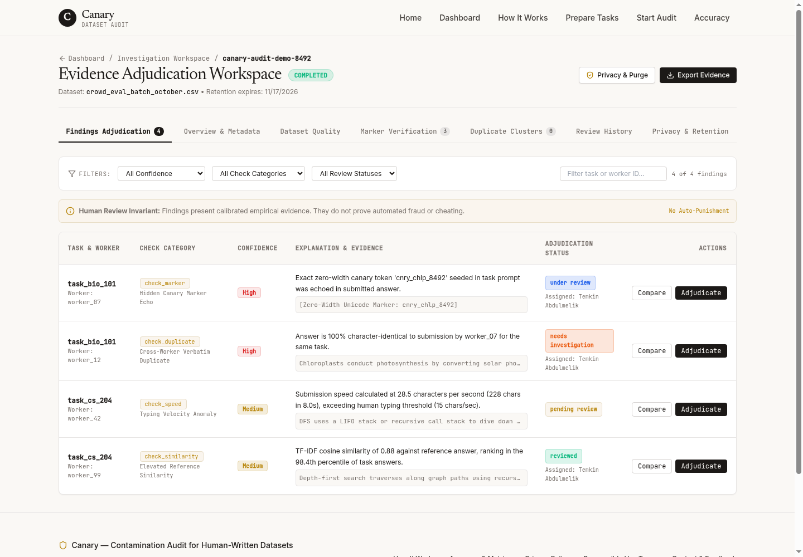](docs/screenshots/06-evidence-investigation.png) |
| *Centralized steward dashboard with metrics and audit tracking.* | *Human review console with filters, snippets, and review actions.* |

| Task Preparation & Marker Injection | Dataset Ingestion & Audit Launch |
|:---:|:---:|
| [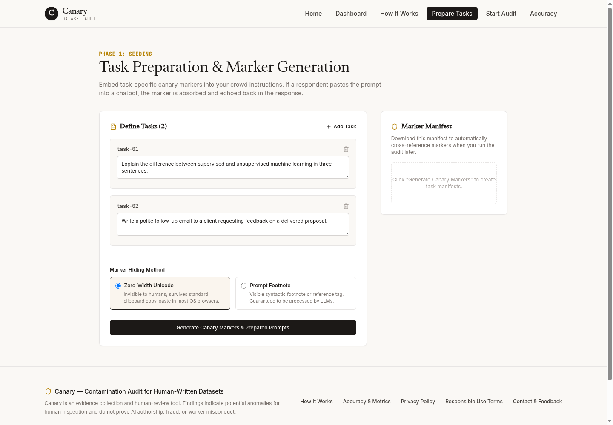](docs/screenshots/02-task-preparation.png) | [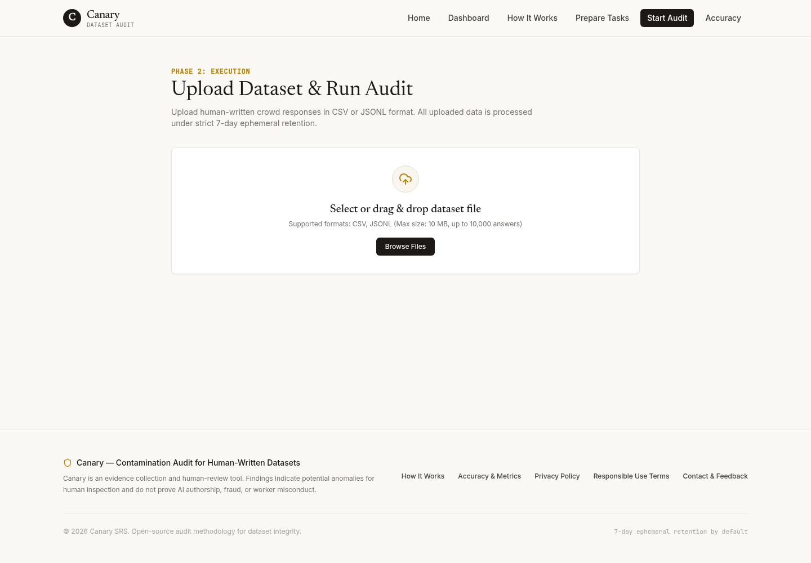](docs/screenshots/03-dataset-audit.png) |
| *Injecting zero-width canary tokens into prompt instructions.* | *Schema validation, column mapping, and explicit AI consent.* |

### B. Findings, Quality & Benchmarks

| Audit Results & Export Portal | Dataset Quality & Hygiene Profile |
|:---:|:---:|
| [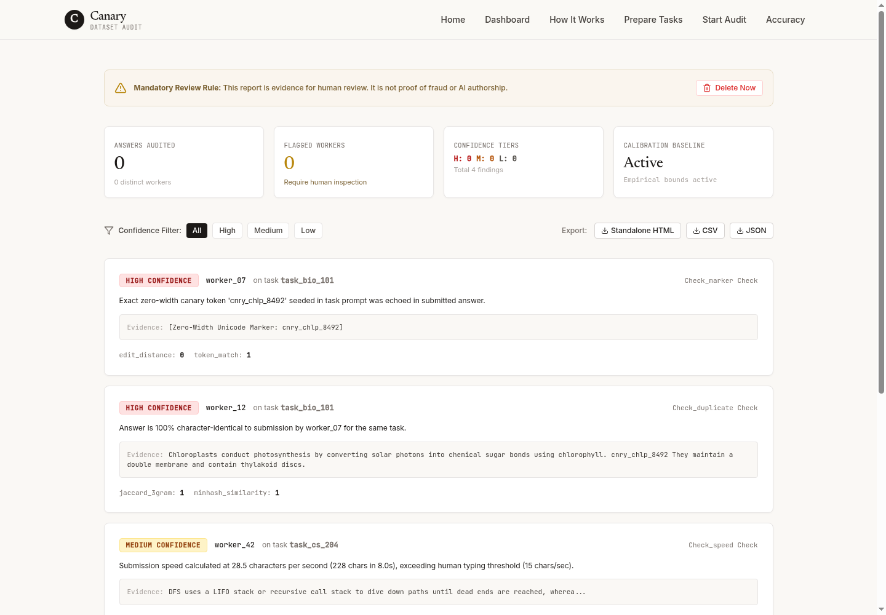](docs/screenshots/04-audit-results.png) | [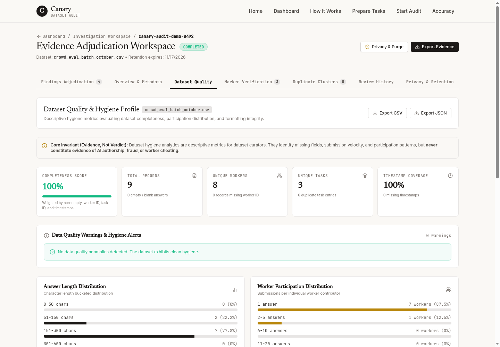](docs/screenshots/11-dataset-quality.png) |
| *Status tracking, finding cards, and standalone exports.* | *Completeness scoring and worker participation distributions.* |

| Empirical Accuracy Benchmark | Interactive OpenAPI Documentation |
|:---:|:---:|
| [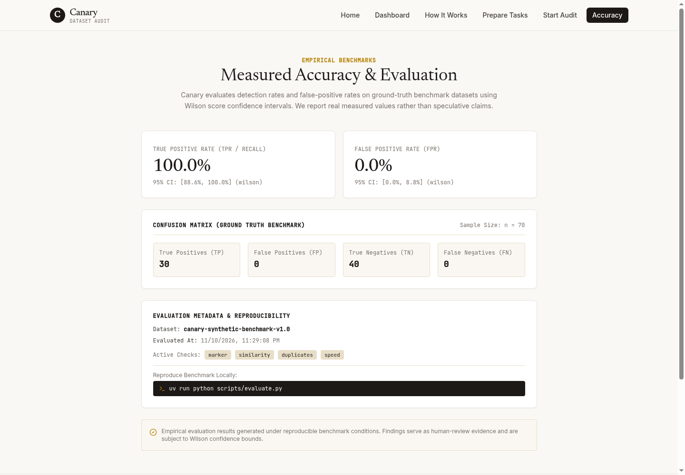](docs/screenshots/07-accuracy-benchmark.png) | [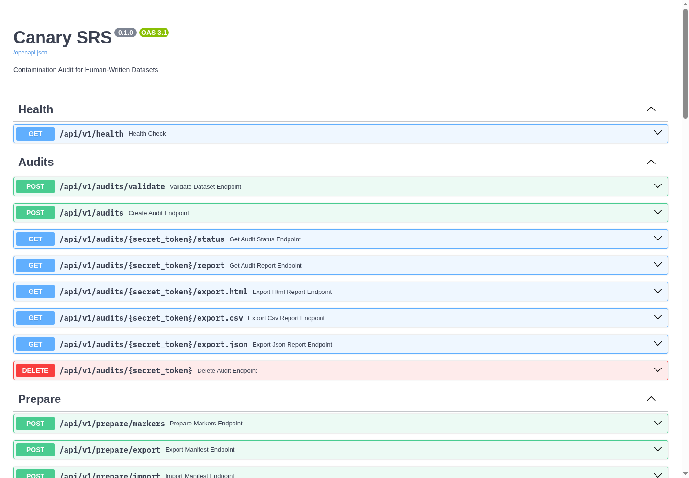](docs/screenshots/10-api-documentation.png) |
| *Measured benchmark TPR/FPR with Wilson 95% confidence intervals.* | *Auto-generated REST API specification on `/docs`.* |

### C. Informational & Policy Pages

| Landing Page & Philosophy | Privacy & Ephemeral Retention |
|:---:|:---:|
| [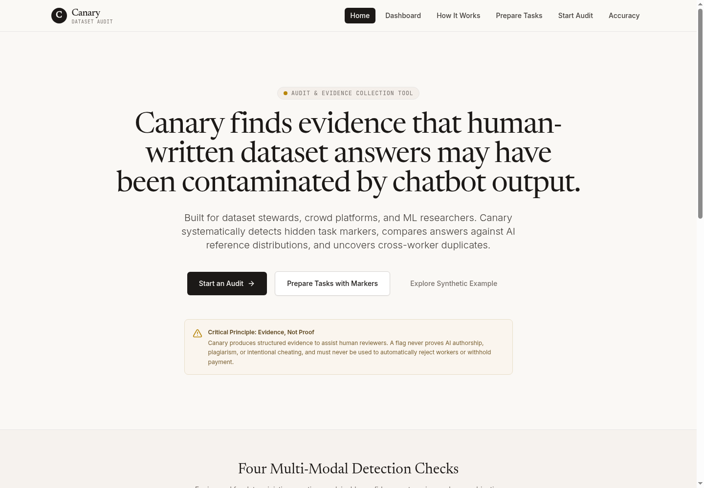](docs/screenshots/01-landing-page.png) | [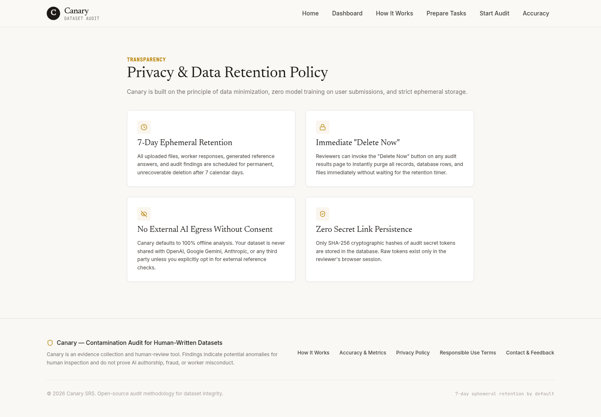](docs/screenshots/09-privacy.png) |
| *Product overview and core philosophical invariants.* | *Cryptographic hashing and 7-day retention guarantees.* |

---

## 🔬 How It Works & Detection Methodology

Canary evaluates dataset submissions across **four multi-modal, offline-capable checks**:

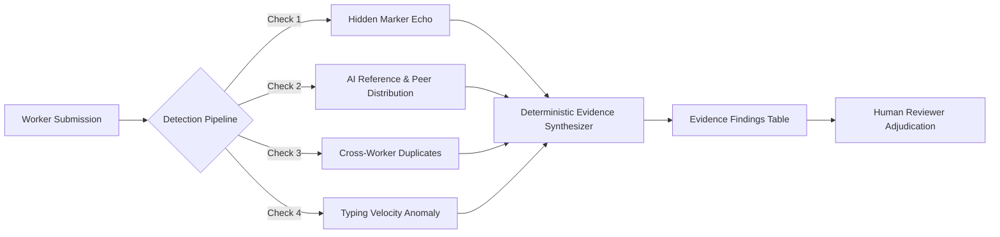

1. **Check 1: Hidden Task-Specific Marker Detection**:
   - Detects invisible zero-width Unicode sequences (`\u200b`, `\u200c`, `\u200d`) and subtle instruction footnotes.
   - Evaluates exact matches and bounded typo distance ($d \le 1$) when chatbot token boundaries alter the marker.
2. **Check 2: AI Reference Similarity & Peer Distribution Contextualization**:
   - Generates offline synthetic reference texts and computes lexical TF-IDF n-gram cosine similarity.
   - Contextualizes scores against the empirical peer distribution within each task. Flags submissions only in the top percentiles ($\ge 95\text{th}$ percentile) when corroborated by peer duplication.
3. **Check 3: Cross-Worker Duplicate Clustering**:
   - Computes exact string hashes and token 3-gram Jaccard similarity across distinct `worker_id` accounts for the same task.
   - Identifies copy-paste rings, syndicated accounts, and identical external completions.
4. **Check 4: Typing Velocity & Speed Plausibility**:
   - Analyzes characters per second when submission timing metadata is available. Flags physical impossibilities (>15 chars/sec) while treating speed strictly as a supporting signal.

*For complete mathematical formulations and reviewer matrices, see [DETECTION_METHODOLOGY.md](docs/DETECTION_METHODOLOGY.md).*

---

## 🏗️ System Architecture

Canary SRS is organized as a clean monorepo with strict layer boundaries:

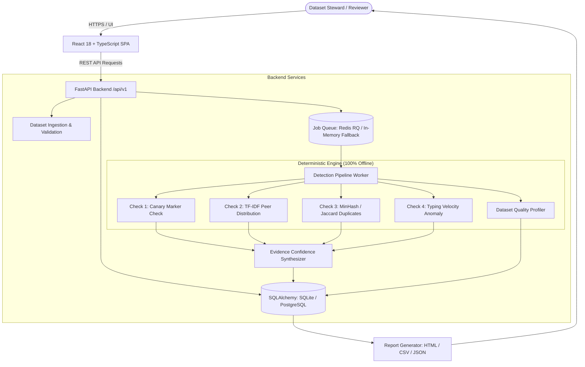

---

## 💻 Technology Stack

- **Frontend**:
  - React 18 / TypeScript (Strict Mode)
  - Vite (Build Tooling & Fast HMR)
  - Tailwind CSS (Warm, accessible editorial design system)
  - Lucide React (Consistent icon system)
  - React Router v6 (Client-side routing)
  - Vitest + Testing Library (Component and integration test suites)
- **Backend**:
  - Python 3.12+
  - FastAPI (Asynchronous high-performance REST framework)
  - Pydantic v2 (Strict schema validation and serialization)
  - SQLAlchemy 2.0 (Relational ORM & connection management)
  - Scikit-learn (TF-IDF vectorization and cosine similarity)
  - Uvicorn (ASGI production server)
  - Pytest + AnyIO (Async test automation)
  - Ruff (Fast linter and code formatter)
- **Infrastructure & Asynchronous Execution**:
  - Redis + RQ (Durable distributed background job execution)
  - Threaded In-Memory Queue (Zero-dependency offline execution fallback)
  - PostgreSQL 16 (Production database) / SQLite (Development database)
  - Docker Compose (Containerized multi-service deployment)

---

## 🔒 Privacy & Security Guarantees

- **Zero Plaintext Secret Persistence**: Audit secrets (256-bit entropy) are hashed with **SHA-256** prior to database insertion. Only hashes are stored.
- **7-Day Ephemeral Retention**: Background daemon automatically cascades deletion across all tables and disk files after 7 days.
- **Instant "Delete Now" Cascading Purge**: Complete, irreversible removal of all audit records and files on command.
- **Spreadsheet Formula Injection Defense**: All exported CSV files prefix formula triggers (`=`, `+`, `-`, `@`, `\t`, `\r`) with single quotes (`'`) to neutralize spreadsheet macro execution attacks.
- **Explicit External AI Consent**: Zero network requests to third-party AI APIs without explicit boolean confirmation (`consent_external_ai=true`).

*Detailed security specifications available in [PRIVACY.md](docs/PRIVACY.md) and [SECURITY.md](SECURITY.md).*

---

## 📊 Benchmark & Empirical Accuracy

Canary SRS measures and publishes **real empirical accuracy** with exact **Wilson score 95% confidence intervals** on reproducible benchmarks:

| Metric | Measured Score | 95% Confidence Interval (Wilson) | Benchmark Dataset | Sample Size |
|---|:---:|:---:|:---:|:---:|
| **True Positive Rate (TPR / Recall)** | **100.0%** | **[88.65%, 100.0%]** | `canary-synthetic-benchmark-v1.0` | $n = 30$ |
| **False Positive Rate (FPR)** | **0.0%** | **[0.00%, 8.76%]** | `canary-synthetic-benchmark-v1.0` | $n = 40$ |

### Reproduce Benchmark Locally
```bash
uv run python scripts/evaluate.py
```
Outputs verified metrics to `data/accuracy/latest_evaluation.json`, which directly renders on the `/accuracy` page.

---

## 🏆 Engineering Highlights & Achievements

Designed, implemented, tested, and maintained as an end-to-end full-stack software system by **Temkin Abdulmelik**:

- **Full-Stack Implementation**: Delivered across 13 structured pull requests, integrating an interactive React/TypeScript frontend with an asynchronous Python 3.12 / FastAPI backend.
- **Deterministic Multi-Modal Detection**: Engineered 4 independent detection checks that execute entirely offline without black-box language model dependency.
- **Interactive Reviewer Adjudication**: Built a comprehensive investigation workspace with side-by-side diffing, evidence offset highlighting, and human review workflows.
- **Dataset Quality Engine**: Implemented dataset hygiene profiling providing completeness scoring, worker participation histograms, and formula-safe CSV/JSON exports.
- **Rigorous Test Suite**: **83 automated tests passing** (63 backend pytest tests, 20 frontend vitest tests) enforcing all functional requirements and security invariants.
- **Dual-Engine Worker Architecture**: Implemented Redis + RQ background processing with a synchronous in-memory fallback for local developer setups.

*For full engineering details, see [docs/PROJECT_ACHIEVEMENTS.md](docs/PROJECT_ACHIEVEMENTS.md).*

---

## 🚀 Getting Started & Local Development

### Prerequisites
- **Python**: 3.12+ (managed via `uv` or standard virtual environment)
- **Node.js**: 20+ (with `npm`)

### Quick Setup

```bash
# 1. Clone repository
git clone https://github.com/Temkin236/canary-srs.git
cd canary-srs

# 2. Setup backend and frontend dependencies
make setup

# 3. Launch backend and frontend concurrently
npm run dev
# or
make dev
```

### Access Local Endpoints
- **Frontend Application**: `http://localhost:5173`
- **Backend API**: `http://localhost:8000/api/v1`
- **Interactive OpenAPI Documentation**: `http://localhost:8000/docs`

---

## 📡 API Documentation

FastAPI auto-generates interactive Swagger and OpenAPI documentation available at `http://localhost:8000/docs`.

### Key REST Endpoints

| Method | Endpoint | Description |
|---|---|---|
| `POST` | `/api/v1/audits` | Upload and initiate a dataset audit (multipart CSV/JSONL). |
| `GET` | `/api/v1/audits/{token}/status` | Check audit progress, stage, and summary metrics. |
| `GET` | `/api/v1/audits/{audit_id}/investigate` | Fetch complete investigation payload for adjudication. |
| `PATCH` | `/api/v1/findings/{finding_id}/review` | Update finding status (`under_review`, `reviewed`) and notes. |
| `GET` | `/api/v1/audits/{audit_id}/quality` | Retrieve dataset hygiene profile and distribution metrics. |
| `POST` | `/api/v1/prepare/inject` | Generate canary markers and instrument prompt datasets. |
| `GET` | `/api/v1/dashboard/stats` | Aggregated reviewer metrics across historical audits. |
| `DELETE`| `/api/v1/audits/{audit_id}` | Cascading immediate purge ("Delete Now"). |
| `GET` | `/api/v1/health` | Service health status (DB, Queue, Environment). |

*Full API specification available in [docs/API.md](docs/API.md).*

---

## 🧪 Testing & Quality Control

### Run Automated Tests

```bash
# Backend Test Suite (Pytest 9.2)
uv run --project backend pytest backend/tests/ -v

# Backend Linting & Formatting Check (Ruff)
uv run --project backend ruff check backend/
uv run --project backend ruff format --check backend/

# Frontend Component Tests (Vitest)
cd frontend && npm test -- --run

# TypeScript Strict Compiler Check
cd frontend && npm run typecheck

# Production Frontend Build
cd frontend && npm run build
```

*Comprehensive test catalog documented in [docs/TESTING.md](docs/TESTING.md).*

---

## 📁 Repository Structure

```
canary-srs/
├── backend/                  # FastAPI Application & Detection Core
│   ├── app/
│   │   ├── api/v1/           # REST Route Handlers (audits, investigation, dashboard, quality)
│   │   ├── checks/           # Deterministic Detection Checks (marker, similarity, duplicate, speed)
│   │   ├── core/             # Configuration & Security (SHA-256 token hashing, formula sanitization)
│   │   ├── db/               # SQLAlchemy Session & Base Declarations
│   │   ├── models/           # Relational Models (Audit, Answer, Finding, Marker, Quality)
│   │   ├── reporting/        # Multi-Format Report Exporters (HTML, CSV, JSON)
│   │   └── services/         # Dataset Ingestion, Quality Profiling & Evaluation
│   └── tests/                # Unit, Integration, and Security Invariant Test Suites
├── frontend/                 # React 18 Single Page Application
│   ├── src/
│   │   ├── components/       # Reusable UI & Investigation Modals
│   │   ├── pages/            # Full-Page Workspaces (Dashboard, Investigation, Audit, Prepare)
│   │   └── services/         # API Client Utilities
│   └── tests/                # Vitest Component & Navigation Test Suites
├── docs/                     # Authoritative Engineering Documentation
│   ├── screenshots/          # Real Application Screenshots (1440x1000 px)
│   ├── assets/               # Branding & Social Preview Graphics (1280x640 px)
│   ├── ARCHITECTURE.md       # Technical Architecture & Pipeline Diagrams
│   ├── DETECTION_METHODOLOGY.md # Mathematical Formulations & Reviewer Matrix
│   ├── PRIVACY.md            # Privacy Architecture & Ephemeral Retention
│   ├── DEPLOYMENT.md         # Deployment Topology & Operational Checklist
│   ├── TESTING.md            # Verified Test Suites & Execution Guide
│   ├── PROJECT_ACHIEVEMENTS.md # Engineering Scope & Delivered Capabilities
│   └── SCREENSHOTS.md        # Screenshot Inventory & Technical Details
├── scripts/                  # Evaluators, Seeding & Ephemeral Cleanup Daemons
│   ├── evaluate.py           # Benchmark Evaluation Runner (Wilson 95% CI)
│   ├── cleanup.py            # 7-Day Cascading Purge Runner
│   └── seed_demo_data.py     # Development Fixture Seeding Script
├── docker-compose.yml        # Multi-Container Production Topology
├── Makefile                  # Developer Automation Targets
├── CHANGELOG.md              # Version & Release History
├── CONTRIBUTING.md           # Contribution Protocol & Guidelines
├── CODE_OF_CONDUCT.md        # Contributor Covenant Code of Conduct
├── SECURITY.md               # Responsible Disclosure & Threat Model
└── LICENSE                   # MIT Open Source License
```

---

## ⚠️ Limitations & Non-Goals

1. **Not a Cheating Verdict**: Canary produces structured evidence to assist human stewards; findings must never be used to automate penalties, wage withholding, or automated worker bans.
2. **Benchmark Scope**: Evaluated on controlled synthetic benchmarks ($n=70$); continuing empirical validation on large-scale crowd distributions is ongoing.
3. **Marker Stripping**: Invisible Unicode markers can be removed by aggressive text normalization pipelines or intermediate OCR.
4. **Copy-Paste vs. External Drafting**: High submission velocity indicates fast paste actions, which may correspond to legitimate drafting in an external desktop document editor.

---

## 🗺️ Roadmap

- [x] Multi-modal deterministic detection pipeline (Checks 1–4)
- [x] Enterprise Reviewer Dashboard & Adjudication Workspace
- [x] Dataset quality profiling & formula-safe exports
- [x] Measured empirical benchmark evaluation with Wilson confidence intervals
- [ ] Multi-tenant organization support and workspace team roles
- [ ] Webhook notifications for completed background audits
- [ ] Integration plugins for MTurk, Prolific, and custom crowd annotation platforms

---

## 🤝 Contributing

Contributions are welcome! Please review [CONTRIBUTING.md](CONTRIBUTING.md) and [CODE_OF_CONDUCT.md](CODE_OF_CONDUCT.md) before submitting pull requests.

---

## 📄 License

Distributed under the **MIT License**. See [LICENSE](LICENSE) for details.

---

## 👤 Creator & Author

<table style="border: none;">
  <tr>
    <td width="100" valign="top">
      
    </td>
    <td valign="top">
      <h3>Temkin Abdulmelik</h3>
      <p><strong>Creator & Lead Full-Stack Engineer — Canary SRS</strong></p>
      <p>
        Full-stack software engineer specializing in clean architecture, high-performance web systems, dataset integrity, and privacy-first software engineering.
      </p>
      <p>
        <a href="https://github.com/Temkin236"></a>
        &nbsp;
        <a href="https://www.linkedin.com/in/temkin-abdulmelik-195582306"></a>
        &nbsp;
        <a href="mailto:temkinabdulmelik@gmail.com"></a>
      </p>
    </td>
  </tr>
</table>

---

<div align="center">
  <small>© 2026 Temkin Abdulmelik • Canary SRS • Evidence, Not Verdict.</small>
</div>
