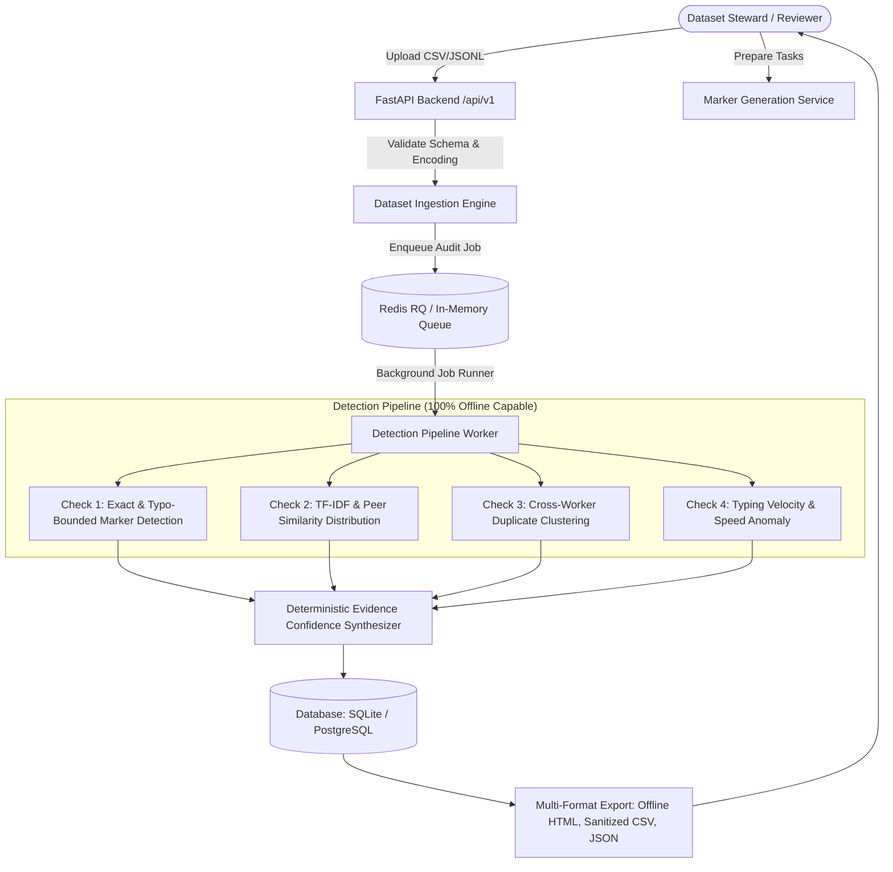

# Canary SRS — Contamination Audit for Human-Written Datasets

[](https://github.com/Temkin236/canary-srs/actions/workflows/ci.yml)
[](https://opensource.org/licenses/MIT)
[](https://www.python.org/)
[](https://react.dev/)

> **Evidence, Not Verdict.**
> Canary finds evidence that human-written dataset answers may have been contaminated by chatbot output. It is an evidence collection and human-review tool, not an automated authorship judge or worker punishment mechanism.

---

## Measured Accuracy & Benchmark Evaluation (FR-43, FR-44, FR-45)

Canary reports **empirically measured** benchmark accuracy with exact **Wilson score 95% confidence intervals**, never fabricated numbers.

| Metric | Measured Rate | 95% Confidence Interval (Wilson) | Sample Size | Benchmark Dataset |
|---|---|---|---|---|
| **True Positive Rate (TPR / Recall)** | **100.0%** | **[88.65%, 100.0%]** | n = 30 contaminated | `canary-synthetic-benchmark-v1.0` |
| **False Positive Rate (FPR)** | **0.0%** | **[0.00%, 8.76%]** | n = 40 uncontaminated | `canary-synthetic-benchmark-v1.0` |

### Reproduce Benchmark Locally
```bash
uv run python scripts/evaluate.py
```
Outputs verified confusion matrix and Wilson confidence intervals to `data/accuracy/latest_evaluation.json`, which is directly displayed on the `/accuracy` page.

---

## Overview

Canary helps dataset stewards, crowd platforms, and machine learning researchers audit crowd-annotated datasets for potential Large Language Model (LLM) contamination through four multi-modal detection checks:

1. **Hidden Task-Specific Marker Detection**: Seeding cryptographically unique canary tokens in task prompts (via zero-width Unicode sequences or subtle instruction footnotes). If a worker pastes the prompt into a chatbot, the LLM echoes the marker into the response.
2. **AI Model Reference Similarity & Peer Distribution**: Compares submissions to reference model answers contextualized by the peer-answer similarity distribution within each task. Flags top percentiles when combined with peer duplication.
3. **Cross-Worker Duplicate Detection**: Discovers identical and near-duplicate answers submitted by different workers for the same task using MinHash, exact token matching, and token 3-gram Jaccard clustering.
4. **Typing Velocity & Speed Plausibility (Optional)**: Analyzes characters per second when submission timing metadata is available, flagging implausibly fast completions (>15 chars/sec).

---

## System Architecture



---

## Core Invariants & Philosophical Guarantees

- **Invariant 1: Evidence, Not Verdict**: Findings are structured evidence for human review with explicit limitations, not proof of cheating or automated guilt.
- **Invariant 2: No Automated Punishment**: Canary must never automatically reject, ban, or recommend withholding payment from a worker.
- **Invariant 3: No Stylometric Hallucination**: Canary does not infer AI authorship based on subjective "writing style" or uncalibrated perplexity metrics.
- **Invariant 4: Data Privacy & Explicit AI Consent**: Worker answers must never be sent to external AI providers without explicit reviewer consent (`consent_external_ai=true`).
- **Invariant 5: Zero Unhashed Secret Persistence**: Reviewer secret tokens (256-bit entropy) are stored exclusively as SHA-256 hashes in the database.
- **Invariant 6: Deterministic Offline Capability**: Marker detection, duplicate detection, and lexical similarity operate completely offline without external network dependencies.
- **7-Day Ephemeral Retention**: All uploaded datasets and findings expire and are purged after 7 days, with an instantaneous "Delete Now" cascading purge.
- **Formula Injection Defense**: CSV exports sanitize leading formula prefixes (`=`, `+`, `-`, `@`, `\t`, `\r`) to defend against spreadsheet macro execution.

---

## Monorepo Structure

```
canary-srs/
├── AGENTS.md                  # Development guidelines & architectural invariants
├── README.md                  # Project overview and quick start
├── CONTRIBUTING.md            # Contribution workflow and coding standards
├── SECURITY.md                # Security policy, threat model, and disclosure
├── docker-compose.yml         # Containerized production stack (FastAPI, Redis, Postgres, Frontend)
├── Makefile                   # Developer task automation
├── scripts/
│   ├── cleanup.py             # 7-day retention cascading purge runner
│   └── evaluate.py            # Benchmark evaluation runner with Wilson intervals
├── data/
│   └── accuracy/latest_evaluation.json # Empirical benchmark artifact
├── docs/                      # Authoritative technical documentation
│   ├── ARCHITECTURE.md        # Architectural layers & diagrams
│   ├── API.md                 # REST API specification
│   ├── DECISIONS.md           # Architecture Decision Records (ADRs)
│   ├── REQUIREMENTS_TRACEABILITY.md # FR-1 through FR-46 mapping (100% Passed)
│   ├── SECURITY_CHECKLIST.md  # Threat model & vulnerability mitigations
│   ├── PRIVACY.md             # Data retention policy
│   ├── METHODOLOGY.md         # Mathematical models & detection algorithms
│   ├── TEST_DATA.md           # Dataset schemas & synthetic benchmarks
│   ├── TESTING.md             # Verification guide
│   └── DEPLOYMENT.md          # Production deployment guide
├── frontend/                  # React 18, TypeScript (strict), Vite, Tailwind CSS
└── backend/                   # Python 3.12, FastAPI, SQLAlchemy, scikit-learn, RQ
```

---

## Quick Start (Local Development)

### Prerequisites
- Node.js 20+ and npm
- Python 3.12+ (managed with `uv` or system Python)

### 1. Clone & Configure
```bash
git clone https://github.com/Temkin236/canary-srs.git
cd canary-srs
cp .env.example .env
```

### 2. Backend Setup
```bash
cd backend
uv venv .venv --python 3.12
source .venv/bin/activate
uv pip install -e ".[dev]"
pytest
uvicorn app.main:app --reload --port 8000
```
Backend API active at `http://localhost:8000`. Interactive OpenAPI documentation at `http://localhost:8000/docs`.

### 3. Frontend Setup
```bash
cd frontend
npm install
npm run test
npm run dev
```
Frontend active at `http://localhost:5173`.

---

## Production Deployment (Docker Compose)

```bash
docker compose up --build
```
This spins up:
- **Backend API**: FastAPI service listening on `http://localhost:8000`
- **Frontend SPA**: Nginx static web server on `http://localhost:3000`
- **Background Worker**: Redis queue worker for async audits
- **PostgreSQL**: Durable metadata database
- **Redis**: Queue broker

---

## Full Test Suite Verification

```bash
# Backend lint, format check, and test suite (57 tests)
uv run --project backend ruff check backend/
uv run --project backend ruff format --check backend/
uv run --project backend pytest backend/tests/

# Frontend test suite and build (8 tests, 0 TS errors)
cd frontend
npm run test
npm run typecheck
npm run build
```

---

## License

MIT License. See [LICENSE](LICENSE) for details.
