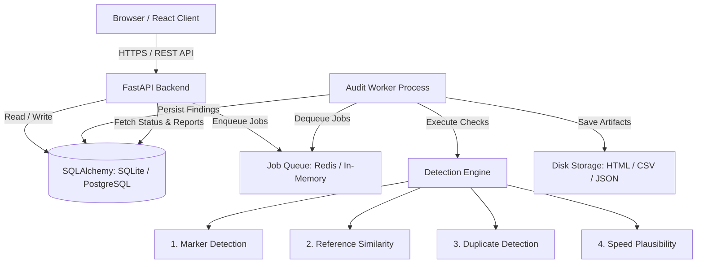

# Architecture Documentation — Canary SRS

## System High-Level Diagram

## Architectural Layers
1. **Frontend Presentation**:
   - Single Page Application built with React 18/19, TypeScript (strict mode), Vite, Tailwind CSS, React Router.
   - Core philosophy: Warm, editorial, accessible UI (warm off-whites `#FAF8F5`, rich charcoal `#1A1A1A`, muted gold `#B8860B`).
   - Zero external tracking or third-party ad scripts.

2. **Backend API**:
   - FastAPI providing asynchronous and synchronous HTTP endpoints.
   - Pydantic v2 schemas for strict payload validation.
   - Secure error handling: Stack traces are caught and logged server-side, never exposed to clients.
   - Hash-based secret URL lookup (SHA-256) preventing plaintext token leaks in database dumps or query logs.

3. **Detection Engine (`app/checks/`)**:
   - Clean separation of detection logic from HTTP routing and UI presentation.
   - **Marker Check (`marker.py`)**: Exact matching, whitespace normalization, case-insensitivity, and bounded typo distance matching (Levenshtein) with configurable thresholds.
   - **Similarity Check (`similarity.py`)**: Multi-reference comparison per provider. Lexical TF-IDF cosine similarity, semantic embedding similarity, and peer percentile ranking within each task group.
   - **Duplicate Check (`duplicates.py`)**: Normalized exact string hashing and n-gram Jaccard / token set similarity between distinct workers on the same task.
   - **Speed Check (`speed.py`)**: Typing speed plausibility check based on character-per-second thresholds when worker timing metadata is present.
   - **Synthesis Engine (`base.py`)**: Deterministic evidence confidence rules (High, Medium, Low) and limitation explanations.

4. **Durable Processing & Worker**:
   - Jobs are persisted in `JobState` and `Audit` database tables with explicit lifecycle states: `queued`, `validating`, `running`, `partially_completed`, `completed`, `failed`, `cancelled`, `expired`.
   - Dual-engine queue support:
     - Redis + RQ for scalable multi-worker production deployments.
     - Threaded in-memory queue fallback for instant offline local development.
   - Safe execution bounds: 20-minute timeout cap, retry backoff, and idempotent stage execution.

5. **Storage & Privacy**:
   - 7-day retention TTL enforced by background cleanup job.
   - "Delete Now" performs instantaneous cascade deletion across DB and filesystem.
